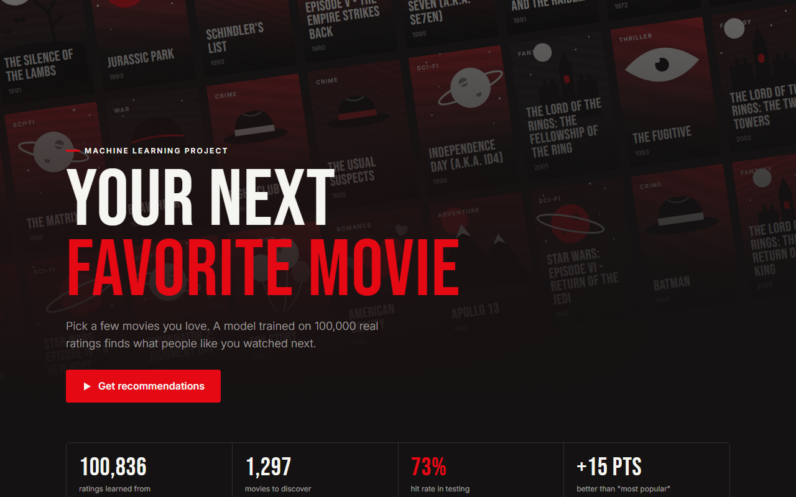
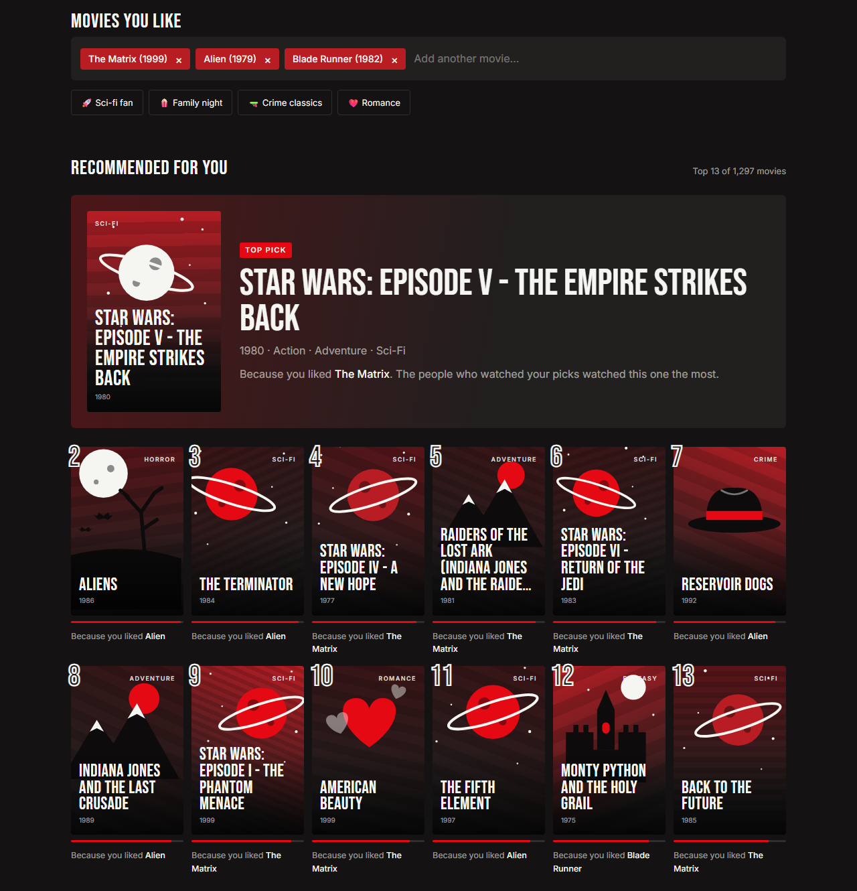
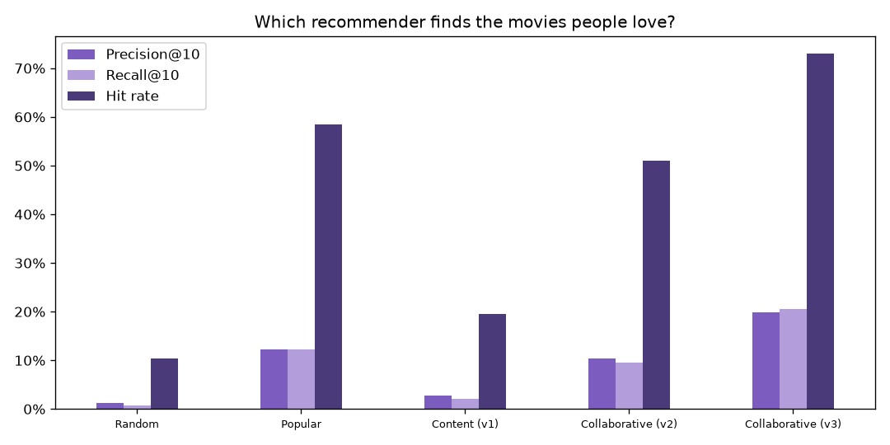
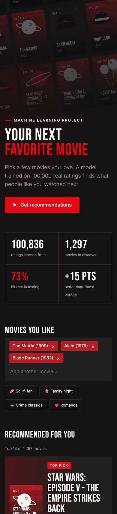

# 🎬 Movie Recommender

**Tell it a few movies you love, and it finds what to watch next.**

This is my first machine learning project. I wanted to understand how "people who liked this also liked…" actually works, so I built one from scratch, measured it honestly, and wrapped it in a small web demo.



## What it does

You pick movies you like (say *The Matrix*, *Alien* and *Blade Runner*), and it recommends 12 more. Each one comes with a short reason, for example "Because you liked Alien", so you can see where it came from.



The interesting part: **the model knows nothing about the movies.** No genres, no plot, no actors. It only knows *who watched what*. It figured out on its own that people who watch *Alien* also watch *Aliens* and *The Terminator*, just from 100,000 real ratings.

## How it works

The technique is called **item-based collaborative filtering**.

1. **Learn:** for every pair of movies, measure how much their audiences overlap (cosine similarity on a user × movie table).
2. **Keep the strongest links:** each movie remembers only its 50 closest "neighbors". Everything else is noise.
3. **Recommend:** every movie you pick votes for its neighbors. The movies with the most votes win.

## Did it actually work?

This is the part I'm proudest of, because the first answer was **no**.

I hid 20% of every user's ratings, trained on the rest, and checked whether each model's top 10 contained movies the user had rated 4★ or more. I also compared against two "dumb" baselines, because a model that can't beat them isn't worth anything.

| Method | Precision@10 | Hit rate |
|---|---:|---:|
| Random picks | 1.2% | 10% |
| v1: Content-based (genres + tags, TF-IDF) | 2.7% | 20% |
| v2: Collaborative, using star ratings | 10.4% | 51% |
| Just recommend the most popular movies | 12.2% | 58% |
| **v3: Collaborative, who-watched-what + 50 neighbors** | **19.9%** | **73%** |



My v2 *looked* great when I tried it by hand: The Matrix gave Fight Club, Memento and Empire Strikes Back. But it scored **worse than just recommending popular movies to everyone**. If I hadn't measured, I would never have known.

Two changes fixed it:
- **Use whether someone watched a movie, not their star rating.** Choosing to watch a movie already says a lot about your taste.
- **Only keep each movie's 50 strongest neighbors**, so thousands of tiny, random similarities stop drowning out the real ones.

Because I picked those settings by looking at the test results, I re-ran everything on a completely different random split to make sure I hadn't fooled myself. It still scored about 19% precision, so the improvement is real.

## Works on phones too



## What I learned

- **Explore the data before modeling.** Half the movies have 3 ratings or fewer. That one fact explains most of the model's weaknesses.
- **Always compare against a simple baseline.** "Recommend popular movies" is surprisingly hard to beat.
- **Your eyes lie, metrics don't.** A list that looks smart can still be worse than a dumb one.
- **Simple methods are powerful.** No neural network here, and it still clearly beats the baselines. Plus it can explain every recommendation.

## Limits (being honest)

- **New movies can't be recommended** until people watch them. This is called the *cold-start* problem.
- **Only 610 users**, so movies with few ratings get weaker results. *The Notebook* is a good example.
- The posters are **illustrations I drew in SVG**, one per genre, not the real movie posters.

## Ideas for next time

- A **hybrid** model: use genres for brand-new movies and behavior for everything else.
- **Matrix factorization**, the technique made famous by the Netflix Prize.
- Try the bigger MovieLens dataset (25 million ratings).

## Run it yourself

The demo needs no install: open `demo/index.html` in a browser.

To rerun the Python steps:

```bash
python -m venv .venv
.venv\Scripts\python.exe -m pip install pandas scikit-learn matplotlib
```

Then download [ml-latest-small.zip](https://grouplens.org/datasets/movielens/latest/) from MovieLens and unzip it into `data/` (it isn't included in this repo). Each step is its own script:

| Script | What it does |
|---|---|
| `01_explore.py` | Looks at the data and draws charts |
| `02_content_based.py "toy story"` | v1: recommends by genres and tags |
| `03_collaborative.py "matrix"` | v2: recommends by ratings |
| `04_evaluate.py` | Scores every method on hidden data |
| `05_export.py` | Exports the best model to `demo/model.js` |

Run any of them with `run.bat <script>`, for example `run.bat 04_evaluate.py`.

## Built with

Python · pandas · scikit-learn · matplotlib · plain HTML, CSS and JavaScript

## Data

[MovieLens](https://grouplens.org/datasets/movielens/) `ml-latest-small` by GroupLens Research: 100,836 ratings from 610 users on 9,742 movies.

> F. Maxwell Harper and Joseph A. Konstan. 2015. The MovieLens Datasets: History and Context. *ACM Transactions on Interactive Intelligent Systems* 5, 4: 19.
